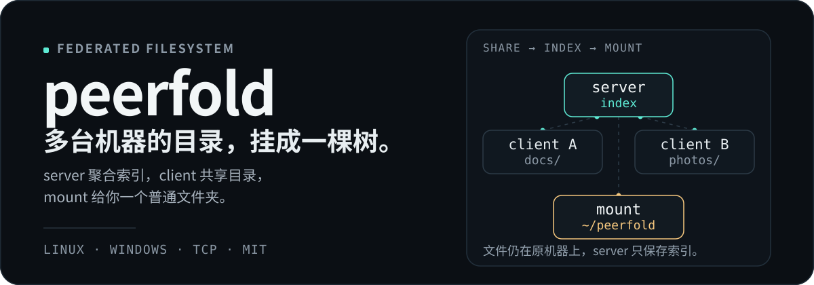
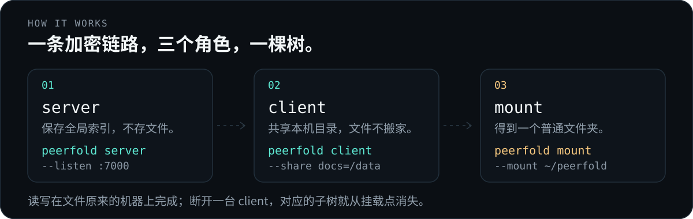

<p align="center">
  
</p>

<p align="center">
  <strong>把多台机器上的目录，挂成一个普通文件夹。</strong><br>
  文件不搬家；Linux 与 Windows 可以混布；默认 TLS 1.3，首次连接粘贴一次登录码。
</p>

---

> **定位：可信局域网。** peerfold 默认启用 TLS 1.3 和登录码登记，未登记的机器连不上；但它不是面向公网的安全产品。细粒度读写授权、token 撤销/过期、限流与配额、端到端加密都未实现。**如果要放到公网，需要自行二次开发这些安全模块。** 详见[安全边界](#安全边界)。

## 为什么用它

文件散在两三台机器上时，SCP、rsync、网盘都会留下副本和同步状态。peerfold 换一种做法：

- **一个挂载点看全部**：每台机器把自己的目录共享出来，挂载端看到的是一棵完整的树。
- **读写像本地目录**：`ls`、`cat`、`put`、`mkdir`、`rm`、`mv` 都是普通文件和目录操作。
- **文件不搬家**：文件始终留在原来的机器上，server 只保存索引、转发请求。
- **跨平台混布**：server、client、mount 可以任意放在 Linux 或 Windows 上。
- **默认加密，一次登记**：server 启动时打印一个登录码，client/mount 首次粘贴后各自拿到本机 token，之后自动连接。

## 它是怎么工作的

<p align="center">
  
</p>

- **server** — 聚合服务端，持有全局索引，不保存文件内容。
- **client** — 把本机的目录按名字共享给 server，可以同时共享多个目录。
- **mount** — 连上 server，把当前所有 client 的共享目录拼成一棵树。

协议是 **TLS 1.3 over TCP**，路径在 wire 上统一用 `/`，本地路径使用各平台自己的分隔符。首次连接只做一次登记：

1. server 首次启动生成自签证书和登记密钥，打印 `login code: PF1.<证书指纹>.<登记密钥>`。
2. client/mount 粘贴这一行；登录码里的指纹用来固定 server 证书，server 校验后给这台机器签发自己的 token。
3. token 写进本机配置（0600），之后启动、重连都直接使用它，不再需要登录码。

## 快速开始

需要 **Go 1.27+**。Linux 还需要 FUSE3，Windows 需要 WinFsp；setup 脚本会尝试自动装好依赖、编译、写 PATH。发行版的 `golang` 太旧时，先从 https://go.dev/dl/ 安装官方工具链。

### 启动 server

在作为 server 的机器上：

```sh
git clone https://github.com/ispengya/peerfold.git
cd peerfold

./setup-server.sh          # Linux
.\setup-server.ps1         # Windows
```

`setup-server` 最后会直接进入交互式启动：已有配置就直接读取，没有就当场询问，然后选择前台或后台运行。启动后会打印登录码：

```text
login code: PF1.<证书指纹>.<登记密钥>
listening on 0.0.0.0:7000
```

把整行登录码复制给下一步。它是这台 server 的登记凭据，不要转发到公开聊天或 issue；后台启动时它也会写进 `~/peerfold-server/log.txt`，该文件是 0600，但日志本身也不要外发。

server 默认监听 `0.0.0.0:7000`，这样局域网里的其他机器才能连上来。只在本机使用时改成 `--listen 127.0.0.1:7000`。**不要做端口映射，也不要在公网主机上直接暴露。**

### 共享目录

在每台要共享目录的机器上：

```sh
./setup-client.sh          # Linux
.\setup-client.ps1         # Windows
```

`setup-client` 只负责构建和安装命令，完成后提示你手动运行 `peerfold client`——这样重跑脚本来更新二进制时，不会顺带把 client 拉起来。装完手动启动：

```sh
peerfold client
```

首次运行会询问登录码、client 名字、server 地址和要共享的目录。粘贴 server 打印的那行即可；名字会成为聚合树的顶层目录，默认是主机名。默认建议的分享目录是 Linux `~/peerfold-shares/<名字>`、Windows `D:\peerfold-shares\<名字>`（D 盘不存在时回退到用户目录），直接回车接受即可。连接成功后，配置里保存的是这台机器自己的 token，之后再启动不会询问登录码。

可以重复 `--share NAME=PATH` 共享多个目录，用 `--exclude PATH` 跳过 `node_modules`、`.git`、`dist` 等目录。

### 挂载聚合树

在要挂载的机器上（装过任意一个 setup 脚本即可）：

```sh
peerfold mount
```

首次运行询问登录码、server 地址和挂载点；之后从 `~/peerfold-mount/config.json` 读取。默认挂载点是 Linux `~/peerfold`、Windows `D:\peerfold`（D 盘不存在时回退到用户目录）。Linux 上挂载点不存在会自动创建，已存在时必须为空；Windows 上由 WinFsp 创建目录。

client 和 mount 各自独立启动：一个只负责共享本地目录，一个只负责挂载聚合树。

### 直接带参数启动

三个角色都是**不带参数进入交互式 setup，带参数就直接跑**。首次登记需要粘贴登录码，命令行没有对应的 flag：先在交互式流程里完成一次登记，之后就可以用参数或自启脚本启动。

```sh
# 服务端
peerfold server --listen 0.0.0.0:7000

# 共享端（可多个 --share / --exclude）
peerfold client --server 192.168.1.10:7000 --name alice \
  --share docs=/home/alice/docs \
  --share photos=/home/alice/photos

# 挂载端
peerfold mount --server 192.168.1.10:7000 --mount ~/peerfold
```

Linux 上挂载点不存在会自动创建，已存在时必须为空；Windows 上由 WinFsp 创建目录。

<details>
<summary>手工编译（不用 setup 脚本）</summary>

Linux 编译要带 fuse3 标签（脚本已处理）：

```sh
# Debian/Ubuntu
sudo apt install libfuse3-dev gcc
# RHEL / OpenCloudOS 系
sudo dnf install fuse3-devel gcc

go build -tags=fuse3 -o peerfold ./cmd/peerfold
```

</details>

## 安全边界

默认安全模型是“**可信局域网 + 登记设备可信**”。已经有的：

- TLS 1.3；server 首次启动生成自签 ECDSA 证书，登录码带证书的 SHA-256 指纹，客户端逐字节固定，不依赖系统 CA，也不做静默 TOFU。
- 每台 client/mount 登记后获得独立 token；server 只保存 token 的 SHA-256；配置、token 文件和日志均为 0600。
- 未登记 peer 无法完成握手；认证材料在 TLS 内传输，控制帧不压缩。
- 名字、相对路径和符号链接都被限制在各自的命名空间和 share 内，拒绝 `..`、绝对路径等越界形状。
- `--insecure` 只是开发调试的逃生口：明文、无认证，不要在不可信网络使用。

没有做，放到公网前必须自行补：

- **细粒度授权**：登记即进入同一信任域。任何已认证 viewer 都能读全部 share；token 里的 `write` 能力虽然记录了，但尚未在写请求入口执行，所以 viewer 目前也能写。
- **撤销、过期、审计与限额**：没有撤销命令、token 过期、连接频率限制、连接数/节点数/单文件大小配额。撤销只能手动改 `tokens.json`。
- **端到端加密**：TLS 只保护传输；server 能看到所有文件名和转发的文件内容。
- **自动化证书轮换**：轮换需要删除证书并重新分发登录码。

如果要在公网或多租户环境使用，请先二次开发上述模块，并配合防火墙、反向代理和访问审计。当前实现只按可信局域网设计，细节和残余风险见 [SECURITY_TODO.md](./SECURITY_TODO.md)。

## 日常使用

| 命令 | 作用 |
| --- | --- |
| `peerfold status` | 查看本机进程和连到 server 的 client/mount |
| `peerfold stop server` | 停止服务端 |
| `peerfold stop client alice` | 停止指定 client |
| `peerfold stop mount` | 停止挂载（Linux 先落盘再卸载） |
| `peerfold stop all` | 全部停止 |
| `peerfold restart server` | 后台重启 |
| `peerfold ls` / `cat` / `put` / `mkdir` / `rm` / `mv` | 直接操作聚合树 |

`peerfold mount` 运行期间会记录自己的 PID 和实际使用的 server / 挂载点，所以从另一个终端也能用 `peerfold status` 看到它；`peerfold stop mount` 会先落盘再卸载（Linux 通过 SIGTERM 触发正常退出，Windows 上是强制结束进程）。

### status 能看到整个联邦

`peerfold status` 会连一次配置里的 server，列出**所有连到这台 server 的 mount 和 client**，包括其他机器上的：

```text
Remote mounts via 192.168.1.10:7000:
  WINBOX  D:\peerfold  from 192.168.1.23:22739  up 3m12s

Clients via 192.168.1.10:7000:
  alice  (aggregate)  from 192.168.1.7:52344  up 8m5s
```

mount 在握手时声明主机名和挂载点，client 握手时声明名称，server 记录连接来源和时间；所以 A 机器上的 mount/client 在 B 机器的 status 里也可见，前提是 B 已经登记。

`status` 以及 `ls`/`cat`/`put` 等命令复用本机配置里的登录码或 token；有多个配置时优先使用带凭据的那个。只跑 server 的机器默认没有 viewer 凭据，需要本机命令时，先用登录码在本机登记一次 mount，或准备一份 viewer 配置，否则这些命令只能连 `--insecure` server。

旧版 server 不认识这些查询，status 会提示更新并重启 server，而不是假装没有远程连接。要让远程信息可见，server 和对应的 mount/client 都需要更新到包含该功能的版本。

## 性能与当前边界

- 读缓存按固定 **256 KiB 块**存储，跨 open 保留；读单位默认 512 KiB，按实测 RTT 在 **256 KiB–1 MiB** 间自适应。一次大读会并发填充，第一次大读触发预读。
- 数据帧按需压缩：实测 `package-lock.json` 约 3.8×、Markdown 约 1.6×；JPEG、zip、视频压不动时自动按原文发送，不会额外浪费带宽。
- `--chunk` 调整读单位基准；`--buffer` / `--buffer-total` 调整单文件/总读缓存（默认 64 MiB / 256 MiB）。
- `--exclude` 让大目录不扫描、不索引、不 watch。
- 当前版本面向 **10 MB 以内**的文件；挂载端写入缓冲为 16 MiB，更大的文件可能以 ENOSPC 失败，而不是被静默截断。

## 跨平台混部注意

| 事项 | 说明 |
| --- | --- |
| 认证 | 默认 TLS 1.3；登录码登记一次，之后用本机 token |
| 默认目录 | 共享：Linux `~/peerfold-shares/<名字>`，Windows `D:\peerfold-shares\<名字>`；挂载：Linux `~/peerfold`，Windows `D:\peerfold` |
| 路径 | wire 上统一 `/`；本地路径用各平台的分隔符 |
| 主机名 | client 默认名：Windows 用 `COMPUTERNAME`，Linux 用 `hostname` |
| 挂载点 | Windows 由 WinFsp 创建目录；Linux 会自动创建，已存在时必须为空 |
| 挂载依赖 | Windows 要 WinFsp；Linux 要 fuse3（`sudo apt install fuse3`） |
| 下线语义 | client 断开 → 挂载里对应子树消失；最后一个 owner 下线 → 挂载点释放 |
| 远程连接 | mount/client 在握手时登记；已登记的机器可以从 `status` 看到，未登记连不上（默认安全模式） |

## 常驻运行与开机自启

交互式选 **Background** 时可以启用自启：

- **Windows**：写入 HKCU `...\CurrentVersion\Run`
- **桌面 Linux**：写入 `~/.config/autostart/peerfold-*.desktop`（XDG）
- **无桌面 Linux**：用 systemd user unit

```ini
# ~/.config/systemd/user/peerfold-server.service
[Unit]
Description=peerfold server
After=network.target

[Service]
ExecStart=%h/.local/bin/peerfold server --daemon --listen 0.0.0.0:7000
Restart=on-failure

[Install]
WantedBy=default.target
```

```sh
systemctl --user enable --now peerfold-server.service
```

后台/自启进程不会提问：登录码在交互设置阶段已经写进 client/mount 配置，首次连接后会替换成本机 token。server 自启沿用同一套证书和登记密钥，登录码保持不变。

## 日志与配置

```text
~/peerfold-server/log.txt
~/peerfold-server/config.json
~/peerfold-server/tls.crt        # server 自签证书
~/peerfold-server/tls.key
~/peerfold-server/enroll.key     # 登录码里的登记密钥
~/peerfold-server/tokens.json    # 每台机器的 token（只存 SHA-256）

~/peerfold-client-<名字>/config.json
~/peerfold-client-<名字>/log.txt
~/peerfold-mount/config.json
```

配置、token 和日志均为 0600；Windows 下依赖用户目录 ACL。后台启动时登录码会出现在 server 日志里，日志本身也不要外发。

`chunk_size`（或 `--chunk`）是读单位基准，实际会按 RTT 在 256 KiB–1 MiB 间调整；`buffer_limit` / `buffer_total` 控制读缓存。`exclude` 是绝对路径列表。

Windows 上是 `C:\Users\你\peerfold-server\log.txt` 这种形式。日志记录每次 list / read / write / mkdir / rename / remove / 文件变化推送，并带有耗时和字节数（例如 `mount: read ... took=... bytes=...`、`server: read ... took=...`、`client: read ... took=...`），可以直接对比慢在网络请求、server 转发还是 owner 读盘。

## 清理

cleanup 脚本会**先停掉正在运行的前台/后台进程**（mount 会正常卸载），再删除配置、日志、token、证书、自启项、旧版 `peerfold-demo` 演示目录和构建产物。不动 FUSE/WinFsp 和系统 PATH，也**不会删除 `peerfold-shares` 里的分享内容**。

```sh
./cleanup.sh          # Linux（从源码目录）
.\cleanup.ps1         # Windows
```

清理后 server 会重新生成证书和登记密钥，登录码随之改变；client/mount 需要重新登记。

## License

MIT
